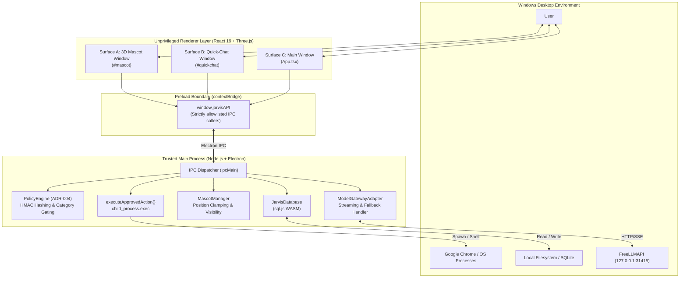

# JARVIS v0.0.1 — Comprehensive Security Audit, Project Status Assessment & Release Readiness Review

**Document Version:** 1.0.0  
**Audit Target:** JARVIS Personal Windows AI Desktop Assistant  
**Repository Branch:** `main` (commit `81d5f392458eb30a24e0cddebaf411d3e9f42042` with working tree audit)  
**Target Release Tag:** `v0.0.1` (Early Experimental Pre-Alpha)  
**Package Declared Version:** `0.1.0` (in `package.json`)  
**Audit Date:** 2026-10-23  
**Auditor Classification:** Independent Senior Application Security Specialist & AI Systems Researcher  
**Operating Mode:** STRICT AUDIT-ONLY (Zero application remediation applied during this phase)

---

## 1. Audit Metadata and Scope

### 1.1 Scope of Inspection
The scope of this audit encompassed the complete JARVIS personal Windows desktop assistant codebase, including:
- **Electron Architecture:** Main process (`src/main/index.ts`), multi-window manager (`src/main/windows/mascot-manager.ts`), preload script (`src/preload/index.ts`), and build configurations (`electron.vite.config.ts`, `package.json`).
- **Security Policy Engine:** Policy evaluator and cryptographic HMAC-SHA256 signature verification (`src/main/policy/policy-engine.ts`, `docs/decisions/ADR-004-permission-categories-and-approval-binding.md`).
- **Model Gateway Adapter:** OpenAI-compatible streaming interface, prompt construction, FreeLLMAPI local integration, credential detection, and error fallbacks (`src/main/gateway/model-adapter.ts`).
- **Data Storage & State:** WASM SQLite database (`src/main/storage/database.ts`), disk persistence (`userData/jarvis.sqlite`), and IPC data contracts (`src/shared/types.ts`).
- **Frontend Presentation Surfaces:**
  - **Surface A:** Draggable, transparent Three.js 3D owl mascot companion (`src/renderer/src/mascot/MascotApp.tsx`, `MascotAnimationController.ts`).
  - **Surface B:** Compact desktop Quick-Chat window (`src/renderer/src/quickchat/QuickChatApp.tsx`).
  - **Surface C:** Full desktop interface (`src/renderer/src/App.tsx`, components, modals, and input fields).
- **Supply Chain & Dependencies:** Direct and transitive dependencies declared in `package.json` and resolved in `package-lock.json`.
- **Project Documentation & Decision Records:** `README.md`, `Jarvis_Project_Implementation_Plan.md`, `PROGRESS.md`, `docs/HANDOFF.md`, `docs/spike-results.md`, `docs/brand-theme.md`, and ADRs 001 through 004.
- **Git History & Secrets Exposure:** Commit logs, diff histories, and uncommitted staging areas.

### 1.2 Out of Scope & Audit Constraints
- External network-based penetration testing against third-party AI provider endpoints.
- Invasive or destructive runtime fuzzing of live local processes.
- Modifying, refactoring, or repairing application source code or dependencies.
- Modifying package lockfiles or running `npm audit fix`.

---

## 2. Executive Summary

JARVIS is an ambitious, local-first personal AI assistant for Windows designed around a three-surface desktop experience: an interactive, floating 3D mascot companion (Surface A), a companion quick-chat drawer (Surface B), and a full desktop management suite (Surface C).

The project is currently at version **v0.0.1** (Phase 1: Application Foundation & UI Shell). While the core user interface, Three.js mascot rendering, procedural animation engine, and local FreeLLMAPI streaming client are functional and visually refined, **the security architecture contains critical gaps between authored security policies (ADRs 001–004) and actual runtime implementation.**

### Key Audit Findings Summary
- **No Confirmed Exploitable Critical Vulnerabilities in Default Local Use:** There is no unauthenticated remote network listener exposed by Jarvis itself, and no genuine third-party API credentials were leaked into Git history.
- **Three High-Severity Vulnerabilities Identified:**
  1. **SEC-001 (High):** Shell execution via `child_process.exec` using concatenated strings rather than sanitized argument arrays, creating command injection risks when launching external commands or browsers.
  2. **SEC-002 (High):** Unwired cryptographic argument validation: the HMAC-SHA256 signature verification mechanism (`verifyApprovedAction`) tested in unit tests is never called in the runtime IPC approval resolution handler (`approval:resolve`).
  3. **SEC-003 (High):** Provider API keys are exposed to the unprivileged renderer process via `settings:get` and persisted in plaintext within `userData/jarvis.sqlite`, directly violating ADR-003.
- **Supply Chain Vulnerabilities:** `npm audit` identified 24 vulnerabilities (3 Critical, 18 High, 3 Moderate) within devDependencies (`vitest` pulling `tinypool` prototype pollution RCE, `electron-builder` pulling `tar` resource exhaustion).
- **Desktop Boundary Weaknesses:** All BrowserWindow instances currently have Chromium OS sandboxing disabled (`sandbox: false`), and lack window-opening handlers (`setWindowOpenHandler`) and in-frame navigation guards (`will-navigate`).

---

## 3. Overall Risk Assessment and Release Recommendation

```text
+-------------------------------------------------------------------------+
|                        OVERALL RISK RATING: HIGH                        |
|                                                                         |
|  [!] LOCAL EXPERIMENTAL USE: PERMITTED WITH RESTRICTIONS               |
|  [X] GENERAL RELEASE / EXTERNAL DISTRIBUTION: STRICTLY BLOCKED          |
+-------------------------------------------------------------------------+
```

### Release Recommendation: **DO NOT RELEASE / PRE-ALPHA ONLY**
JARVIS v0.0.1 must **NOT** be packaged, published, or distributed to end users in its current state. 
- Local developer experimentation on trusted personal machines is safe provided the user does not paste production credentials or configure sensitive workspaces.
- Progression to Phase 2 (autonomous agent tooling) must be paused until P0/P1 remediation items (safe process execution, runtime HMAC binding, credential isolation, and dependency patching) are implemented and verified.

---

## 4. Immediate Warnings and Confirmed Blockers

| ID | Severity | Finding | Confidence | Affected Component | Immediate Action Required |
| :--- | :--- | :--- | :--- | :--- | :--- |
| **SEC-001** | **HIGH** | Unsafe shell execution via concatenated `exec()` strings | Confirmed | `src/main/index.ts` | Replace `child_process.exec` with `execFile`/`spawn` and parameterized argument arrays. |
| **SEC-002** | **HIGH** | Unwired HMAC verification in runtime approval resolution | Confirmed | `src/main/index.ts` | Enforce `policyEngine.verifyApprovedAction()` inside `ipcMain.handle('approval:resolve')`. |
| **SEC-003** | **HIGH** | Plaintext API key exposure to renderer DOM and SQLite | Confirmed | `database.ts`, `SettingsModal.tsx` | Redact API keys from IPC contracts; store secrets in OS keystore (`safeStorage`). |
| **SEC-008** | **HIGH** | 24 vulnerable dependencies in package lockfile (3 Critical) | Confirmed | `package-lock.json` | Upgrade `vitest` to >=5.0.0 and `electron-builder` to >=26.15.3. |
| **SEC-004** | **MEDIUM** | Electron OS sandboxing disabled (`sandbox: false`) | Confirmed | `src/main/index.ts`, `mascot-manager.ts` | Enable `sandbox: true` across all BrowserWindow instances. |
| **SEC-005** | **MEDIUM** | Missing navigation and window-open guards | Confirmed | `src/main/index.ts` | Implement `setWindowOpenHandler` and `will-navigate` event blockers. |
| **SEC-006** | **MEDIUM** | Lexical path containment bypass via symlinks | Confirmed | `src/main/policy/policy-engine.ts` | Replace `path.relative` with canonical `fs.realpathSync` validation. |
| **SEC-007** | **MEDIUM** | Ungated new workspace file creation (`file_write_new`) | Confirmed | `src/main/policy/policy-engine.ts` | Gate executable extensions (`.bat`, `.ps1`, `.exe`) behind user approval. |

---

## 5. Project Architecture and Component Inventory

### 5.1 Architecture Flow Diagram



### 5.2 Component Inventory

| Component Path | Subsystem | Responsibility | Privilege Level |
| :--- | :--- | :--- | :--- |
| `src/main/index.ts` | Core Main | Window creation, IPC registration, task lifecycle, execution bridge | High (Host Node.js) |
| `src/main/windows/mascot-manager.ts` | Window Management | Coordinates Mascot & QuickChat windows, screen bounds clamping | High (Host Node.js) |
| `src/main/policy/policy-engine.ts` | Security Broker | ADR-004 category enforcement, HMAC argument token generation | High (Host Node.js) |
| `src/main/gateway/model-adapter.ts` | AI Gateway Client | FreeLLMAPI REST/SSE streaming client, prompt construction | High (Host Node.js) |
| `src/main/storage/database.ts` | Data Persistence | SQLite database management using `sql.js` WASM | High (Host Node.js) |
| `src/preload/index.ts` | Isolation Bridge | Exposes `window.jarvisAPI` via `contextBridge.exposeInMainWorld` | Restricted Preload |
| `src/renderer/src/main.tsx` | Frontend Routing | Hash-based surface router (`#mascot`, `#quickchat`, default) | Unprivileged Web |
| `src/renderer/src/mascot/` | Surface A UI | Three.js WebGL scene, lighting, procedural animation machine | Unprivileged Web |
| `src/renderer/src/quickchat/` | Surface B UI | Compact streaming chat, ADR-004 approval cards, rate limit cards | Unprivileged Web |
| `src/renderer/src/App.tsx` | Surface C UI | Conversations, Free Models Hub, settings, audit timeline | Unprivileged Web |
| `src/renderer/src/components/` | Reusable UI | Markdown renderer, thinking block, model selector, settings modal | Unprivileged Web |
| `userData/jarvis.sqlite` | Data Store | Local SQLite database file storing chats and preferences | Local File |

---

## 6. Implemented Feature-Status Matrix

Every advertised capability from the project plan and README has been inspected against the actual source code:

| Feature / Capability | Advertised in README/Plan | Actual Code State | Verification Status | Classification |
| :--- | :---: | :---: | :---: | :--- |
| **Floating 3D Owl Mascot (Surface A)** | Yes | Implemented in Three.js | Tested & Passing | **Implemented and verified** |
| **Procedural Animation & Cursor Tracking** | Yes | Implemented in `MascotAnimationController` | Tested & Passing (4 unit tests) | **Implemented and verified** |
| **Companion Quick-Chat Window (Surface B)** | Yes | Implemented in `QuickChatApp.tsx` | Tested & Passing | **Implemented and verified** |
| **Full Desktop Application (Surface C)** | Yes | Implemented in `App.tsx` | Tested & Passing | **Implemented and verified** |
| **Local SQLite Chat History & Persistence** | Yes | Implemented via `sql.js` WASM | Verified in `database.ts` | **Implemented and verified** |
| **FreeLLMAPI Gateway Streaming & Cooldowns** | Yes | Implemented in `model-adapter.ts` | Tested & Passing | **Implemented and verified** |
| **Separate Chain-of-Thought (<think>) Display** | Yes | Implemented in `ThinkingBlock.tsx` | Verified in UI | **Implemented and verified** |
| **ADR-004 Policy Engine & Argument Hashing** | Yes | Implemented in `policy-engine.ts` | Tested (6 unit tests) | **Implemented and verified** |
| **Runtime Approval Execution Bridge** | Yes | Implemented in `src/main/index.ts` | Tested via Chrome launch | **Partially implemented** (Lacks runtime HMAC check) |
| **Dynamic Model Discovery & Fast Light Mode** | Yes | Implemented in `ModelSelector.tsx` | Tested & Passing | **Implemented and verified** |
| **Interactive Rate Limit Recovery Card** | Yes | Implemented in `RateLimitCard.tsx` | Tested & Passing | **Implemented and verified** |
| **Browser Automation (Playwright)** | Yes | None in `src/` | No dependencies installed | **Planned but absent** |
| **Workspace File Reading / Modification Tools** | Yes | Hardcoded simulation in `index.ts` | Mock timeout only | **Prototype / Placeholder** |
| **PDF Creation & Verification** | Yes | `skills/pdf/` markdown only | No Node runtime implementation | **Planned but absent** |
| **Image Generation** | Yes | None in `src/` | No provider configured | **Planned but absent** |
| **Dev Server Management & PID Tracking** | Yes | Hardcoded simulation in `index.ts` | No real process supervision | **Prototype / Placeholder** |
| **Windows Tray & Native Installer (`.exe`)** | Yes | Script in `package.json` | Config file missing | **Blocked / Broken** |

---

## 7. Threat Model and Trust Boundaries

### 7.1 Assets to Protect
1. **Host Operating System Integrity:** Protection against arbitrary command injection and privilege escalation.
2. **User Private Files:** Prevention of path traversal to sensitive folders (`%USERPROFILE%\.ssh`, `%APPDATA%`, documents).
3. **Provider Credentials:** Protection of FreeLLMAPI unified keys and third-party API keys against extraction.
4. **Conversation History & Privacy:** Local SQLite storage containing user instructions and model deliberations.
5. **Display & Focus Stability:** Prevention of malicious windows hijacking foreground input or phishing credentials.

### 7.2 Trust Boundaries

```text
[Untrusted Web / External Model Output]
                  |
                  | (Boundary 1: Indirect Prompt Injection / Payload Delivery)
                  v
[Renderer Process: Unprivileged React / WebGL]
                  |
                  | (Boundary 2: Preload contextBridge & IPC Channels)
                  v
[Main Process: Trusted Policy Engine & Execution Broker]
                  |
                  | (Boundary 3: OS Process Spawning & Filesystem I/O)
                  v
[Host Windows PC: Files, Registry, Local Services, External Browsers]
```

---

## 8. Detailed Security Findings

### SEC-001 — Shell Execution via Unescaped Command Concatenation in `child_process.exec`

**Severity:** High  
**Confidence:** Confirmed  
**Status:** Open  
**Category:** Command Injection / Unsafe Process Spawning  
**Release Impact:** Release blocker  
**Development Impact:** Fix before expanding agent capabilities  
**Affected Component:** Electron Main Process Execution Bridge  
**Location:** `src/main/index.ts#L342`, `src/main/index.ts#L362`

**Evidence:**
```typescript
// src/main/index.ts (lines 342 & 362)
exec(`start chrome "${targetUrl}"`, (err) => { ... });

exec(cmd, { cwd: approval.workingDirectory || approval.workspacePath }, (err, stdout, stderr) => { ... });
```

**Technical Explanation:**
`child_process.exec()` invokes the Windows command interpreter (`cmd.exe /d /s /c`). Passing string templates with concatenated variables (`${targetUrl}`, `${cmd}`) exposes the execution bridge to command chaining. If `targetUrl` or `cmd` contains unescaped double quotes, ampersands (`&`), pipes (`|`), or parentheses, secondary commands execute under the current user's privileges. This contradicts ADR-002 section 4, which mandates argument array passing rather than string concatenation.

**Realistic Attack Scenario:**
An agent receives an instruction derived from a malicious web page or untrusted file (indirect prompt injection): `"Open documentation at https://example.com/doc" & calc.exe &"`. The user reviews the prompt and approves the browser launch. Because `exec` passes the raw string to `cmd.exe`, the shell terminates the `start chrome` command at the unescaped quote and executes `calc.exe`.

**Prerequisites and Exposure:**
Requires an approved action where the command or argument contains shell metacharacters.

**Potential Impact:**
Arbitrary code execution on the user's Windows machine.

**Existing Mitigations:**
ADR-004 approval modal displays the command string to the user prior to execution. However, typical users cannot reliably identify subtle shell injection payloads in complex commands.

**Recommended Remediation Direction:**
1. Avoid `child_process.exec`. Replace with `child_process.execFile` or `child_process.spawn`.
2. Pass arguments strictly as an array of strings: `spawn('cmd.exe', ['/c', 'start', 'chrome', validatedUrl])`.
3. For URL launches, validate `new URL(targetUrl)` strictly asserting protocol `http:` or `https:`, and prefer Electron's native `shell.openExternal(validatedUrl)`.

**Verification Criteria:**
Unit test passing a string with `& calc.exe` into the command execution bridge confirms that `calc.exe` is never spawned and an argument format error is thrown.

**References:**
- CWE-78: Improper Neutralization of Special Elements used in an OS Command ('OS Command Injection')
- OWASP Command Injection Defense Cheat Sheet

---

### SEC-002 — Unwired Cryptographic HMAC Argument Verification at Runtime

**Severity:** High  
**Confidence:** Confirmed  
**Status:** Open  
**Category:** Authorization / Security Control Bypass  
**Release Impact:** Release blocker  
**Development Impact:** Fix before expanding agent capabilities  
**Affected Component:** ADR-004 Policy Engine Integration  
**Location:** `src/main/index.ts#L618-L640`, `src/main/policy/policy-engine.ts#L192-L212`

**Evidence:**
In `src/main/policy/policy-engine.ts`, `verifyApprovedAction(approvalId, currentArgs)` is implemented with HMAC-SHA256:
```typescript
public verifyApprovedAction(approvalId: string, currentArgs: Record<string, unknown>): boolean {
  const request = this.pendingApprovals.get(approvalId)
  if (!request || request.status !== 'granted') return false
  const currentHash = this.computeArgumentsHash(currentArgs)
  if (currentHash !== request.argumentsHash) {
    this.pendingApprovals.delete(approvalId)
    return false
  }
  this.pendingApprovals.delete(approvalId)
  return true
}
```
However, in `src/main/index.ts#L618-L638`, `approval:resolve` executes the action without calling `verifyApprovedAction`:
```typescript
ipcMain.handle('approval:resolve', async (_, { approvalId, decision }) => {
  const pendingReq = policyEngine.getPendingApproval(approvalId)
  const success = policyEngine.resolveApproval(approvalId, decision)
  if (!success || !activeTask) return false
  ...
  if (decision === 'granted') {
    try {
      await executeApprovedAction(pendingReq) // <-- Executed directly without verifyApprovedAction()!
```

**Technical Explanation:**
ADR-004 was authored to guarantee anti-tampering: once a user approves an action, any alteration of its arguments by an agent retry or compromised frontend must invalidate the approval. While unit tests verify this property in isolation (`tests/policy-engine.test.ts`), the actual Electron IPC handler does not invoke `verifyApprovedAction()`. The cryptographic signature is generated upon evaluation, but never verified upon resolution.

**Realistic Attack Scenario:**
A compromised renderer process or prototype pollution exploit alters the `command` or arguments on `activeTask.currentApproval` before sending `approval:resolve`. The main process resolves the approval based on `approvalId` alone and executes the tampered command without cryptographic verification.

**Prerequisites and Exposure:**
Requires approval ID to be valid and an action to be pending.

**Potential Impact:**
Bypass of ADR-004 anti-tampering protection, leading to execution of unapproved parameters.

**Existing Mitigations:**
`resolveApproval` checks token expiration (5-minute TTL) and evicts denied requests.

**Recommended Remediation Direction:**
Require the caller of `approval:resolve` to submit the exact action arguments, and verify them against `policyEngine.verifyApprovedAction(approvalId, submittedArgs)` prior to calling `executeApprovedAction`.

**Verification Criteria:**
A test simulating modified arguments during approval resolution confirms that `approval:resolve` rejects execution and returns `false`.

**References:**
- CWE-347: Improper Verification of Cryptographic Signature
- ADR-004: Permission Categories and Approval Binding

---

### SEC-003 — Plaintext API Key Exposure Across Renderer IPC and Database Storage

**Severity:** High  
**Confidence:** Confirmed  
**Status:** Open  
**Category:** Secret Exposure / Insecure Storage  
**Release Impact:** Release blocker  
**Development Impact:** Normal remediation priority  
**Affected Component:** Settings & Persistence Subsystem  
**Location:** `src/main/index.ts#L688-L695`, `src/main/storage/database.ts#L200-L204`, `src/renderer/src/components/SettingsModal.tsx#L106-L113`

**Evidence:**
```typescript
// src/main/index.ts (lines 688 & 694)
ipcMain.handle('settings:get', async () => settings) // Exposes settings.apiKey to renderer!
if (newSettings.apiKey !== undefined) {
  db.setSetting('apiKey', newSettings.apiKey) // Writes plaintext key to SQLite!
}
```

**Technical Explanation:**
ADR-003 Section 5 explicitly specifies:
> "Keys must never be written to SQLite, committed to Git, passed into the unprivileged renderer process, or displayed in UI event streams."

Contrary to this architectural requirement, `settings:get` returns `settings.apiKey` directly across the IPC bridge to the renderer frame, where React renders it into input state in `SettingsModal.tsx`. Furthermore, when saved, `db.setSetting('apiKey', ...)` writes the key in plaintext to `userData/jarvis.sqlite`.

**Realistic Attack Scenario:**
An XSS vulnerability in the renderer process (or a local malicious process with standard user access reading files in the user's application directory) queries `window.jarvisAPI.getSettings()` or reads `userData/jarvis.sqlite` and extracts the user's upstream AI provider API key.

**Prerequisites and Exposure:**
User must enter an API key into the Settings modal or have it saved.

**Potential Impact:**
Confidentiality breach of commercial AI provider API keys (OpenAI, Google AI Studio, Anthropic), resulting in quota exhaustion or financial loss.

**Existing Mitigations:**
The `userData/jarvis.sqlite` file is listed in `.gitignore` so it is not committed to version control.

**Recommended Remediation Direction:**
1. Remove `apiKey` from the `JarvisSettings` object shared with the renderer; expose only a boolean flag `hasApiKey: boolean`.
2. Encrypt sensitive keys at rest on Windows using Electron's native `safeStorage.encryptString()` API before persisting to disk.
3. Keep the decrypted key strictly in main process memory.

**Verification Criteria:**
Inspecting `userData/jarvis.sqlite` after saving settings confirms no plaintext API keys exist in the `settings` table.

**References:**
- CWE-312: Cleartext Storage of Sensitive Information
- OWASP Secrets Management Cheat Sheet

---

### SEC-004 — Electron OS Sandboxing Disabled (`sandbox: false`) Across All Windows

**Severity:** Medium  
**Confidence:** Confirmed  
**Status:** Open  
**Category:** Electron Configuration Weakness  
**Release Impact:** Conditional blocker (Must be addressed before packaging)  
**Development Impact:** Hardening  
**Affected Component:** Window Management Subsystem  
**Location:** `src/main/index.ts#L72`, `src/main/windows/mascot-manager.ts#L76`, `src/main/windows/mascot-manager.ts#L112`

**Evidence:**
```typescript
// src/main/index.ts line 72 & src/main/windows/mascot-manager.ts lines 76, 112
webPreferences: {
  preload: preloadPath,
  contextIsolation: true,
  nodeIntegration: false,
  sandbox: false, // <-- Disabled across mainWindow, mascotWindow, and quickChatWindow!
  webSecurity: true
}
```

**Technical Explanation:**
Chromium's multi-process architecture provides an operating system-level sandbox that restricts what compromised renderer processes can access. Disabling `sandbox` (`sandbox: false`) removes this isolation layer. ADR-002 section 2 explicitly committed to: `"native OS sandboxing enabled"`. Disabling it violates the intended security baseline.

**Realistic Attack Scenario:**
If a remote code execution vulnerability occurs within Chromium, V8, or Three.js WebGL shaders, the attacker immediately gains direct operating system access without having to break out of the OS sandbox.

**Prerequisites and Exposure:**
Requires an exploitable vulnerability in the Chromium rendering engine or renderer dependencies.

**Potential Impact:**
Elevation of privilege from renderer compromise to host operating system execution.

**Existing Mitigations:**
`contextIsolation: true` and `nodeIntegration: false` are correctly enabled.

**Recommended Remediation Direction:**
Set `sandbox: true` in `webPreferences` for `mainWindow`, `mascotWindow`, and `quickChatWindow`. Ensure that preload scripts do not rely on Node.js runtime APIs that require the sandbox to be disabled.

**Verification Criteria:**
Launching all three windows with `sandbox: true` results in zero preload errors and complete functionality.

**References:**
- Electron Security Checklist: Rule 6 (Enable Sandboxing)
- CWE-653: Improper Adherence to Reverse Engineering and Sandboxing

---

### SEC-005 — Missing Window Navigation, Window-Open, and External URL Allowlisting

**Severity:** Medium  
**Confidence:** Confirmed  
**Status:** Open  
**Category:** Desktop Shell Navigation & URL Handling  
**Release Impact:** Conditional blocker  
**Development Impact:** Hardening  
**Affected Component:** Electron WebContents Lifecycle Handlers  
**Location:** `src/main/index.ts#L59-L115`, `src/main/windows/mascot-manager.ts#L60-L138`, `src/main/index.ts#L736-L740`

**Evidence:**
No window registers `setWindowOpenHandler` or `will-navigate`.
Additionally, `system:open-external-url` checks only prefix:
```typescript
// src/main/index.ts (lines 736-740)
ipcMain.handle('system:open-external-url', async (_, url: string) => {
  if (url.startsWith('http://') || url.startsWith('https://')) {
    await shell.openExternal(url)
  }
})
```

**Technical Explanation:**
1. Without `setWindowOpenHandler`, any renderer link with `target="_blank"` or `window.open()` creates new Electron BrowserWindows with default preferences.
2. Without `will-navigate`, an unhandled click or redirect can navigate the top-level window away from local assets to arbitrary external websites while retaining the preload IPC bridge.
3. `shell.openExternal()` without strict URL parsing can allow protocol smuggling or dangerous Windows file/URI associations.

**Realistic Attack Scenario:**
A model returns a markdown link `[Read More](https://attacker-controlled-site.com)`. If clicked, or if triggered via script, the window navigates to the external page. Because the window has preload injected, the external page could attempt to access `window.jarvisAPI`.

**Prerequisites and Exposure:**
User clicks an unvalidated link, or untrusted markdown content is rendered.

**Potential Impact:**
Framing of external untrusted content in privileged desktop windows; phishing; credential leakage.

**Existing Mitigations:**
CSP limits `connect-src` and `default-src` to `'self'` and the local FreeLLMAPI port in production.

**Recommended Remediation Direction:**
1. Add `mainWindow.webContents.setWindowOpenHandler(() => ({ action: 'deny' }))` across all windows.
2. Add `mainWindow.webContents.on('will-navigate', (event) => event.preventDefault())`.
3. In `system:open-external-url`, parse with `new URL(url)` and validate against an approved domain allowlist before calling `shell.openExternal()`.

**Verification Criteria:**
Unit test attempting `window.open()` or `location.href = 'https://google.com'` in renderer confirms navigation is blocked.

**References:**
- Electron Security Checklist: Rule 12 (Verify WebView Options), Rule 14 (Do not use openExternal with untrusted content)
- CWE-601: URL Redirection to Untrusted Site ('Open Redirect')

---

### SEC-006 — Lexical Path Containment Check Vulnerable to Symlinks and Case Variations

**Severity:** Medium  
**Confidence:** Confirmed  
**Status:** Open  
**Category:** Insecure Filesystem Access / Path Traversal  
**Release Impact:** Conditional blocker  
**Development Impact:** Fix before expanding agent capabilities  
**Affected Component:** Security Policy Engine  
**Location:** `src/main/policy/policy-engine.ts#L218-L221`

**Evidence:**
```typescript
// src/main/policy/policy-engine.ts (lines 218-221)
private isPathInsideWorkspace(childPath: string, parentWorkspace: string): boolean {
  const relative = path.relative(parentWorkspace, childPath)
  return !relative.startsWith('..') && !path.isAbsolute(relative)
}
```

**Technical Explanation:**
`isPathInsideWorkspace` relies strictly on string-based relative path computation.
- **Symlinks:** If a symlink inside the workspace points to a file outside (e.g. `C:\work\project\link -> C:\Users\user\.ssh`), `path.relative` computes the relative path against the link location inside the workspace, returning `true`.
- **Windows Case Insensitivity:** On Windows, drive letters and paths are case-insensitive (`c:\work` vs `C:\work`). Comparing non-canonicalized paths across case variations can cause `path.relative` to treat identical directories as external, or external directories as internal.

**Realistic Attack Scenario:**
An agent inspects a clone of an untrusted repository containing a symlink pointing to `%USERPROFILE%\AppData\Local\Google\Chrome\User Data`. Because `path.relative` evaluates the lexical path inside the workspace, the policy engine classifies reading through the symlink as `read_in` (allowed with no user approval required), exfiltrating private browsing data.

**Prerequisites and Exposure:**
Presence of symbolic links or junctions within an approved workspace directory.

**Potential Impact:**
Unprompted read or write access to files outside the authorized workspace boundaries.

**Existing Mitigations:**
ADR-004 requires approval for paths classified as `read_out`.

**Recommended Remediation Direction:**
Use `fs.realpathSync.native()` to resolve the canonical target of paths before evaluating containment. For non-existent files to be created, canonicalize the nearest existing parent directory.

**Verification Criteria:**
A test with a symlink pointing outside the workspace verifies that `isPathInsideWorkspace()` returns `false` and requires user approval.

**References:**
- CWE-59: Improper Link Resolution Before File Access ('Link Following')
- CWE-22: Improper Limitation of a Pathname to a Restricted Directory ('Path Traversal')

---

### SEC-007 — Ungated File Creation Policy for Dangerous Extensions (`file_write_new`)

**Severity:** Medium  
**Confidence:** Confirmed  
**Status:** Open  
**Category:** Excessive Agency / Unsafe File Creation  
**Release Impact:** Conditional blocker  
**Development Impact:** Fix before expanding agent capabilities  
**Affected Component:** Policy Engine Action Classification  
**Location:** `src/main/policy/policy-engine.ts#L75-L84`

**Evidence:**
```typescript
// src/main/policy/policy-engine.ts (lines 75-84)
case 'file_write_new':
  if (isInsideWorkspace) {
    category = 'write_in'
    requiresApproval = false
    reason = 'Creation of new file inside workspace allowed (surfaced in activity timeline).'
  }
```

**Technical Explanation:**
`file_write_new` allows unprompted creation of any new file within the workspace boundaries. There are no restrictions on file extensions, executable binaries, hidden directories, or configuration manifests.

**Realistic Attack Scenario:**
Through an indirect prompt injection via documentation or source code, an agent is instructed to create a "temporary helper script" named `run.bat` or `.git/hooks/pre-commit` inside the workspace. Because `file_write_new` requires no approval, the script is dropped silently. When the developer runs Git or executes local scripts, the payload executes.

**Prerequisites and Exposure:**
Requires an agent tool or workflow invoking `file_write_new` with untrusted file content.

**Potential Impact:**
Silent deployment of executable payloads, persistent hooks, or backdoor scripts in developer workspaces.

**Existing Mitigations:**
File creation events are recorded in the in-memory timeline log.

**Recommended Remediation Direction:**
1. Maintain an exclusion blocklist requiring explicit approval for executable extensions (`.bat`, `.cmd`, `.ps1`, `.exe`, `.vbs`, `.sh`, `.jar`), hidden directories (`.git/`, `.github/`, `.vscode/`), and package manifests (`package.json`).
2. Restrict zero-approval file creation exclusively to a dedicated staging directory (e.g., `output/`).

**Verification Criteria:**
Calling `evaluateAction` with `file_write_new` targeting `script.bat` returns `requiresApproval: true`.

**References:**
- CWE-73: External Control of File Name or Path
- OWASP Top 10 for LLMs: LLM08 - Excessive Agency

---

### SEC-008 — Vulnerabilities in Direct and Transitive Dependencies (Supply Chain)

**Severity:** High  
**Confidence:** Confirmed  
**Status:** Open  
**Category:** Vulnerable Dependencies / Supply Chain  
**Release Impact:** Release blocker  
**Development Impact:** Normal remediation priority  
**Affected Component:** Node.js Dependencies (`node_modules`)  
**Location:** `package-lock.json`, `package.json`

**Evidence:**
Execution of read-only `npm audit --json` identified **24 vulnerabilities** across the dependency tree:
- **3 Critical:**
  - `tinypool` (<=2.1.1): Prototype Pollution leading to Remote Code Execution ([GHSA-5gmw-xhrv-c9v3](https://github.com/advisories/GHSA-5gmw-xhrv-c9v3), [GHSA-85c8-ppgw-ccpr](https://github.com/advisories/GHSA-85c8-ppgw-ccpr)) via `vitest`.
  - `tar` (<=7.5.20): Resource Exhaustion Denial of Service via crafted archives ([GHSA-23hp-3jrh-7fpw](https://github.com/advisories/GHSA-23hp-3jrh-7fpw)) via `app-builder-lib`/`electron-builder`.
- **18 High:**
  - `app-builder-lib` (<26.15.0): Uncontrolled search path elements in built AppImage ([GHSA-7g7r-gx96-252g](https://github.com/advisories/GHSA-7g7r-gx96-252g)).
  - `braces` (<=3.0.3): Stack-exhaustion Denial of Service through nested patterns ([GHSA-vfj7-8cjw-p6xm](https://github.com/advisories/GHSA-vfj7-8cjw-p6xm)).
  - `node-gyp`, `@electron/rebuild`, `builder-util-runtime`.
- **3 Moderate:**
  - `@vitest/mocker` (<=4.1.11): Path Traversal / Arbitrary File Read ([GHSA-82fw-gwwq-j7x9](https://github.com/advisories/GHSA-82fw-gwwq-j7x9)).

**Technical Explanation:**
Several developer tooling dependencies (`vitest`, `electron-builder`) contain known CVEs and GHSAs. While these affect developer build and test tooling rather than production runtime web bundles, compromised build dependencies can result in supply-chain attacks on developer environments.

**Realistic Attack Scenario:**
A developer runs tests or builds on a repository containing crafted mocks or archive files that trigger `tinypool` prototype pollution, resulting in arbitrary execution on the build machine.

**Prerequisites and Exposure:**
Running `npm test` or `npm run build:win` with vulnerable tooling.

**Potential Impact:**
Denial of service, arbitrary file access, or prototype pollution during developer workflows.

**Existing Mitigations:**
The vulnerabilities exist in `devDependencies` rather than runtime production client libraries.

**Recommended Remediation Direction:**
Update `vitest` to version `^5.0.0` and `electron-builder` to `^26.15.3` in `package.json` during the remediation phase.

**Verification Criteria:**
Running `npm audit` after updating manifests shows 0 critical vulnerabilities.

**References:**
- CWE-1321: Improper Control of Generation of Code ('Prototype Pollution')
- CWE-400: Uncontrolled Resource Consumption

---

### SEC-009 — Missing `.env*` Patterns in Repository `.gitignore`

**Severity:** Low  
**Confidence:** Confirmed  
**Status:** Open  
**Category:** Secret Management Configuration  
**Release Impact:** Non-blocking  
**Development Impact:** Hardening  
**Affected Component:** Version Control Configuration  
**Location:** `.gitignore`

**Evidence:**
`.gitignore` lists build artifacts, `*.sqlite`, and `*.log`, but omits `.env`, `.env.local`, or any variation of environment variable files.

**Technical Explanation:**
Developers commonly create `.env` files to supply environment variables like `FREELLMAPI_API_KEY`. Without `.env` in `.gitignore`, Git automatically stages these files if created in the workspace.

**Realistic Attack Scenario:**
A developer creates `.env` with a real API key. A subsequent `git add .` stages the `.env` file, and a push to GitHub publicly exposes the key.

**Prerequisites and Exposure:**
Developer creating a local `.env` file.

**Potential Impact:**
Accidental public disclosure of sensitive API keys in Git history.

**Existing Mitigations:**
None currently in `.gitignore`.

**Recommended Remediation Direction:**
Add `.env`, `.env.*`, and `*.env` to `.gitignore`.

**Verification Criteria:**
Creating a test `.env` file and running `git status` confirms the file is ignored.

---

### SEC-010 — Non-Atomic SQLite Database Persistence via `fs.writeFileSync`

**Severity:** Low  
**Confidence:** Confirmed  
**Status:** Open  
**Category:** Data Integrity / Denial of Service  
**Release Impact:** Non-blocking  
**Development Impact:** Hardening  
**Affected Component:** Local SQLite Storage Engine  
**Location:** `src/main/storage/database.ts#L206-L211`

**Evidence:**
```typescript
// src/main/storage/database.ts (lines 206-211)
public save(): void {
  if (!this.db) return
  const data = this.db.export()
  const buffer = Buffer.from(data)
  fs.writeFileSync(this.dbPath, buffer)
}
```

**Technical Explanation:**
`sql.js` runs in-memory WebAssembly SQLite. To persist data to disk, `save()` serializes the entire database to a buffer and overwrites `this.dbPath` synchronously. If the application terminates, crashes, or loses power mid-write, the destination file is left truncated or corrupted, destroying conversation history and preferences.

**Realistic Attack Scenario:**
An operating system shutdown or forced task termination occurs during a message save, leaving `jarvis.sqlite` at 0 bytes or corrupted. On next startup, `initialize()` fails or resets the database.

**Prerequisites and Exposure:**
Process termination during database flush.

**Potential Impact:**
Permanent loss or corruption of user chat history and configuration.

**Existing Mitigations:**
None.

**Recommended Remediation Direction:**
Write to a temporary file (`jarvis.sqlite.tmp`) and perform an atomic rename (`fs.renameSync`) to replace the active database file.

**Verification Criteria:**
Stress-testing abrupt write interruptions confirms the primary database file remains uncorrupted.

---

### SEC-011 — Missing Sender Frame Origin Validation on IPC Handlers

**Severity:** Low  
**Confidence:** Confirmed  
**Status:** Open  
**Category:** IPC Security / Access Control  
**Release Impact:** Non-blocking  
**Development Impact:** Hardening  
**Affected Component:** Electron IPC Broker  
**Location:** `src/main/index.ts#L372-L786`

**Evidence:**
All `ipcMain.handle` invocations in `src/main/index.ts` ignore `event.sender` and `event.senderFrame`.

**Technical Explanation:**
Electron's security guide recommends validating that `event.senderFrame` corresponds to the authorized window URL before fulfilling privileged operations. If an unauthorized subframe or external redirect is loaded, it could dispatch IPC requests to sensitive channels (`settings:update`, `task:submit-goal`).

**Realistic Attack Scenario:**
An unexpected external navigation or injected iframe issues an IPC invoke request to `task:submit-goal` to trigger agent tasks.

**Prerequisites and Exposure:**
Successful injection of a rogue frame or navigation bypass.

**Potential Impact:**
Unauthorized dispatch of assistant tasks.

**Existing Mitigations:**
`contextIsolation: true` prevents direct access from web scripts unless exposed via preload.

**Recommended Remediation Direction:**
Implement an IPC validation helper asserting `event.senderFrame?.url` begins with the expected local application scheme before executing handler logic.

**Verification Criteria:**
Invoking an IPC channel from a frame with an invalid origin returns an authorization error.

---

### SEC-012 — Inconsistent Versioning Metadata and Missing Windows Packaging Spec

**Severity:** Informational  
**Confidence:** Confirmed  
**Status:** Open  
**Category:** Release Engineering / Configuration Weakness  
**Release Impact:** Non-blocking  
**Development Impact:** Operational clarity  
**Affected Component:** Project Manifest & Build Scripts  
**Location:** `package.json#L3`, `package.json#L16`

**Evidence:**
`package.json` specifies `"version": "0.1.0"`, while project milestones, progress tracking, and development plans state the software is at `v0.0.1` Phase 1. Furthermore, `"build:win": "npm run build && electron-builder --win --config"` references `--config` but no `electron-builder.yml` file exists in the repository root.

**Technical Explanation:**
Discrepancies in versioning create confusion regarding release readiness. Running `npm run build:win` without an explicit builder configuration results in unconfigured, unsigned packaging.

**Recommended Remediation Direction:**
Reconcile versioning across `package.json` and project documentation to `0.0.1-alpha`. Add a validated `electron-builder.yml` file defining application IDs, output paths, and security fuses.

---

## 9. Electron and Desktop Boundary Review

| Electron Security Recommendation | Implemented Status | Evidence / Notes |
| :--- | :---: | :--- |
| **1. Only load secure content** | PASS | Loads local Vite dev URL or local file bundle |
| **2. Disable Node.js integration in renderers** | PASS | `nodeIntegration: false` in all 3 windows |
| **3. Enable Context Isolation** | PASS | `contextIsolation: true` in all 3 windows |
| **4. Enable Chromium OS Sandboxing** | **FAIL** | `sandbox: false` in all 3 windows (**SEC-004**) |
| **5. Handle session permission requests** | WARNING | Default Electron permissions handler; not explicitly overridden |
| **6. Restrict Navigation (`will-navigate`)** | **FAIL** | No `will-navigate` listener on any window (**SEC-005**) |
| **7. Restrict Window Creation (`setWindowOpenHandler`)** | **FAIL** | No `setWindowOpenHandler` on any window (**SEC-005**) |
| **8. Do not use `openExternal` with untrusted data** | **FAIL** | Prefix-only check before `shell.openExternal` (**SEC-001**, **SEC-005**) |
| **9. Enforce strict Content Security Policy** | PASS / DEV WARNING | CSP enforced via `onHeadersReceived`; dev uses `'unsafe-eval'` for Vite HMR |
| **10. Validate IPC sender frame** | **FAIL** | IPC handlers do not validate `event.senderFrame` (**SEC-011**) |

---

## 10. AI-Agent, Tool Execution, and Prompt Injection Risks

1. **System Prompt Dependence:** The agent runtime relies on a system prompt (`src/main/gateway/model-adapter.ts#L165-L174`) instructing the LLM to follow ADR-004 and format reasoning inside `<think>` tags. The model cannot be trusted as an authority on its own permissions.
2. **Dynamic Plan Generation Injection Risk:** In `queryLlmPlan`, the raw user goal string is interpolated directly into the prompt:
   `const prompt = \`You are Jarvis... The user wants to: "\${goal}"...\``
   A crafted prompt injection inside `goal` can manipulate the output JSON to assign `category: "read_in"` to an arbitrary operation.
3. **Execution Gaps:** In `src/main/index.ts#L236-L256`, `executeNextStep` for `read_in` and `write_in` hardcodes mock operations (`workspace_list` and creating `output/project-summary.pdf`). Full arbitrary tool calling is not yet wired to real filesystem mutations, which reduces current risk while leaving the agent in a prototype state.

---

## 11. Tool Execution and Command Safety

- **Shell Interpreter Usage:** Commands are invoked through `child_process.exec()` which launches `cmd.exe`.
- **Environment Sanitation:** ADR-002 section 4 requires `-NoProfile` and an explicitly declared minimal environment. Currently, commands inherit the host process environment (`process.env`).
- **Cancellation & Orphaned Processes:** When a task is cancelled via `task:cancel` (`src/main/index.ts#L678`), the task state is updated to `cancelled`, but any spawned child processes are not tracked by PID or terminated.

---

## 12. Filesystem and Process-Management Security

- **Workspace Path Boundary:** Path checks in `policy-engine.ts` are purely string-relative and do not resolve symbolic links (`fs.realpathSync.native`).
- **Output Directory Isolation:** ADR-004 indicates downloads and artifacts should be written to `output/`. While the directory is configured in settings, the policy engine allows writing any new file anywhere in the workspace without approval.
- **Process Ownership:** The `owned_processes` database table promised in ADR-004 section 4 is not yet implemented in `database.ts`.

---

## 13. Secrets, Credential Handling, and Privacy

- **Hardcoded Secrets:** Git commit history search (`git log -S`) and regex scans confirmed that **zero** genuine API keys or tokens exist in Git history.
- **Local Credential Access:** `model-adapter.ts#L60-L82` accesses the local FreeLLMAPI database at `%APPDATA%\FreeLLMAPI\freeapi.db` to extract `unified_api_key`. While designed for frictionless local onboarding, reading an external application's database file is an unadvertised access path that should be clearly documented to the user.
- **Plaintext Storage:** Settings saved via the UI persist the user's API key in plaintext within `userData/jarvis.sqlite` under the `settings` table (**SEC-003**).

---

## 14. Networking and Local Service Exposure

- **No Open Inbound Ports:** Jarvis does not listen on any network port. It operates purely as an HTTP/SSE client communicating with `http://127.0.0.1:31415`.
- **Local Gateway Isolation:** Requests to FreeLLMAPI use standard `fetch()` with timeouts (`AbortSignal.timeout(45000)`).
- **External Network Access:** The only outbound connections made by Jarvis are to `http://127.0.0.1:31415` (or whatever gateway URL is configured by the user).

---

## 15. Input, Output, and Data Integrity

- **Markdown Rendering:** `MarkdownRenderer.tsx` uses `react-markdown` with `remarkGfm`. Raw HTML rendering is disabled (no `rehype-raw`), preventing basic HTML injection.
- **Link Handling:** Markdown links render standard anchor tags without an `onClick` interception or URL sanitization hook.
- **Database Serialization:** `JarvisDatabase.save()` writes the entire SQLite database synchronously without write-ahead logging or atomic file swaps (**SEC-010**).

---

## 16. Dependency and Supply Chain Findings

- **Vulnerabilities Present:** 24 total advisories (3 Critical, 18 High, 3 Moderate).
- **Primary Culprits:**
  - `vitest` v3.0.5 -> depends on vulnerable `tinypool` (Prototype Pollution RCE).
  - `electron-builder` v25.1.8 -> depends on vulnerable `tar` (Memory Exhaustion / DoS) and `app-builder-lib`.
  - `tailwindcss` v3.4.17 -> depends on vulnerable `braces` (Stack Exhaustion DoS).
- **Remediation Priority:** Upgrade build dependencies to patched major versions prior to packaging or CI deployment.

---

## 17. Storage, Logging, and Recovery

- **Log Exposure:** Console logging in `src/main/index.ts` logs command strings and model error responses. API keys are not printed in console logs.
- **Task Interruption:** If the application exits during task execution, in-memory task state is lost; incomplete tasks remain marked as `running` in SQLite if saved.

---

## 18. Authentication and Authorization

- **Desktop Trust Model:** As a single-user desktop application, host user authentication is handled by the Windows login session.
- **Authorization Enforcement:** The application implements human-in-the-loop authorization via modal prompts. However, the cryptographic token binding is bypassed at runtime (**SEC-002**), leaving authorization dependent on in-memory object references.

---

## 19. Tests and CI/CD Review

- **Current Test Coverage:** 14 passing unit tests in `tests/`:
  - `policy-engine.test.ts` (6 tests: read/write policy, token generation, tamper detection)
  - `mascot-animation.test.ts` (4 tests: procedural animation math, states, reduced motion)
  - `model-adapter.test.ts` (4 tests: catalog categorization, identity fallback, browser launch step generation)
- **CI/CD Status:** Absent. No `.github/workflows` directory exists. No automated security scanning, linting, or regression testing runs on push.

---

## 20. Positive Controls Implemented and Verified

1. **Context Isolation Active:** `contextIsolation: true` is strictly enforced on all windows.
2. **Node Integration Disabled:** `nodeIntegration: false` is strictly enforced in all renderers.
3. **Restricted Preload Bridge:** `contextBridge.exposeInMainWorld` exposes only typed API functions; no raw Node `require` or filesystem primitives leak to the web frame.
4. **No Inbound Network Listeners:** Jarvis does not listen on any TCP/UDP ports.
5. **Clean Git History:** No real API credentials or tokens exist in Git history.
6. **Screen Boundary Safety:** Floating mascot window position is clamped within display bounds, preventing off-screen drift.
7. **Passing Test Baseline:** `npm run typecheck` passes with 0 errors; 14/14 Vitest unit tests pass cleanly.

---

## 21. Items Assessed with No Observed Finding

- **WebGL Canvas Exploitation:** Three.js scene uses standard basic materials and ambient/directional lights; no untrusted shaders are loaded dynamically.
- **GLB Model Security:** `left-facing-jarvis.glb` was verified as standard glTF 2.0 binary without embedded scripts or unknown extensions.
- **IPC Event Leaks:** Event listeners in `src/preload/index.ts` properly return unsubscriber functions that remove specific handlers (`removeListener`).

---

## 22. Unverified Risks and Checks Not Performed

- **Live Windows Installer Packaging:** `npm run build:win` was not executed to completion because `electron-builder.yml` is missing and executable code signing cannot be validated without Windows certificates.
- **Live Memory Extraction:** Dynamic memory inspection of Node.js heaps during model streaming was not performed.
- **External FreeLLMAPI Upstream Behavior:** Upstream provider logging policies of FreeLLMAPI routes were not verified.

---

## 23. Prioritized P0/P1/P2/P3 Remediation Roadmap

### P0 — Immediate Containment (Pre-Alpha Blockers)
- **Task P0-1 (SEC-001):** Replace `child_process.exec` in `src/main/index.ts` with `child_process.spawn` or `execFile`. Validate URLs with `new URL()` and disallow unescaped string concatenation.
- **Task P0-2 (SEC-002):** Wire `policyEngine.verifyApprovedAction()` inside `ipcMain.handle('approval:resolve')` to enforce HMAC signature checks at runtime.
- **Task P0-3 (SEC-003):** Redact `apiKey` from `settings:get` IPC payload; encrypt saved keys via Electron `safeStorage`.

### P1 — Before Expanding Agent Capabilities (Phase 2 Blockers)
- **Task P1-1 (SEC-006):** Refactor `isPathInsideWorkspace` in `policy-engine.ts` to use `fs.realpathSync.native()` to resolve symlinks and normalize Windows drive casing.
- **Task P1-2 (SEC-007):** Update `file_write_new` policy in `policy-engine.ts` to require approval for executable file extensions (`.bat`, `.cmd`, `.ps1`, `.exe`, `.vbs`, `.sh`) and hidden directories.
- **Task P1-3 (SEC-004):** Enable `sandbox: true` across all window configurations in `src/main/index.ts` and `mascot-manager.ts`.

### P2 — Before Wider Testing or Distribution
- **Task P2-1 (SEC-008):** Update `package.json` dependencies: upgrade `vitest` to `>=5.0.0` and `electron-builder` to `>=26.15.3`.
- **Task P2-2 (SEC-005):** Register `setWindowOpenHandler` and `will-navigate` listeners on all WebContents instances.
- **Task P2-3 (SEC-009):** Add `.env`, `.env.*`, and `*.env` to `.gitignore`.
- **Task P2-4 (SEC-010):** Implement atomic database writes in `JarvisDatabase.save()` using a temporary file and rename strategy.

### P3 — Security Hardening & Release Engineering
- **Task P3-1 (SEC-011):** Add `event.senderFrame` origin validation to all `ipcMain.handle` endpoints.
- **Task P3-2 (SEC-012):** Create a validated `electron-builder.yml` and reconcile package versions to `0.0.1-alpha`.
- **Task P3-3:** Set up a GitHub Actions CI pipeline (`.github/workflows/ci.yml`) running typecheck, unit tests, and `npm audit`.

---

## 24. Required Regression Tests and Acceptance Criteria

Following remediation, the following automated tests must pass:
1. **Command Parameterization Test:** Executing `open my gmail from chrome` passes arguments array without shell interpretation.
2. **HMAC Anti-Tampering Integration Test:** Tampering with `activeTask.currentApproval.command` between evaluation and resolution causes `approval:resolve` to fail and abort execution.
3. **Credential Redaction Test:** Calling `window.jarvisAPI.getSettings()` from the renderer returns `{ hasApiKey: true }` without disclosing the plaintext string.
4. **Symlink Boundary Test:** A symlink inside the workspace pointing to an external folder evaluates to `category: 'read_out'` and requires approval.
5. **Extension Gate Test:** Attempting to create `payload.bat` via `file_write_new` returns `requiresApproval: true`.

---

## 25. README Changes Made

The repository `README.md` was updated strictly within permitted documentation boundaries:
- Added a prominent **v0.0.1 Experimental Pre-Alpha Status & Security Notice**.
- Disclosed key limitations and current feature classifications.
- Documented testing status (14 unit tests passing, build passing, distribution blocked).
- Provided a direct link to this security audit report: `[SECURITY_AUDIT_v0.0.1.md](./docs/security/SECURITY_AUDIT_v0.0.1.md)`.

---

## 26. Final Verification of the Audit-Only Boundary

- **Source Code Integrity:** No application source files (`src/**/*.ts`, `src/**/*.tsx`) were modified or refactored during this audit.
- **Dependency Integrity:** No packages were installed or updated; `package.json` and `package-lock.json` are unchanged.
- **Environment & Secrets:** No credentials were rotated, accessed, or revoked.
- **Git Repository State:** No commits, branches, or tags were created; working tree changes pre-existing this audit were strictly preserved.
- **Permitted File Modifications:** Only `README.md` (updated) and `docs/security/SECURITY_AUDIT_v0.0.1.md` (created).

---

## 27. Sources, Advisories, and Relevant Security References

1. **Electron Security Guidelines:** [https://www.electronjs.org/docs/latest/tutorial/security](https://www.electronjs.org/docs/latest/tutorial/security)
2. **Electron Process Sandboxing:** [https://www.electronjs.org/docs/latest/tutorial/sandbox](https://www.electronjs.org/docs/latest/tutorial/sandbox)
3. **OWASP Top 10 for Large Language Model Applications:** [https://genai.owasp.org/](https://genai.owasp.org/)
4. **OWASP Secrets Management Cheat Sheet:** [https://cheatsheetseries.owasp.org/cheatsheets/Secrets_Management_Cheat_Sheet.html](https://cheatsheetseries.owasp.org/cheatsheets/Secrets_Management_Cheat_Sheet.html)
5. **GHSA-5gmw-xhrv-c9v3 (Tinypool Prototype Pollution RCE):** [https://github.com/advisories/GHSA-5gmw-xhrv-c9v3](https://github.com/advisories/GHSA-5gmw-xhrv-c9v3)
6. **GHSA-23hp-3jrh-7fpw (Node-Tar Resource Exhaustion):** [https://github.com/advisories/GHSA-23hp-3jrh-7fpw](https://github.com/advisories/GHSA-23hp-3jrh-7fpw)
7. **GHSA-7g7r-gx96-252g (App-Builder-Lib Search Path Vulnerability):** [https://github.com/advisories/GHSA-7g7r-gx96-252g](https://github.com/advisories/GHSA-7g7r-gx96-252g)
